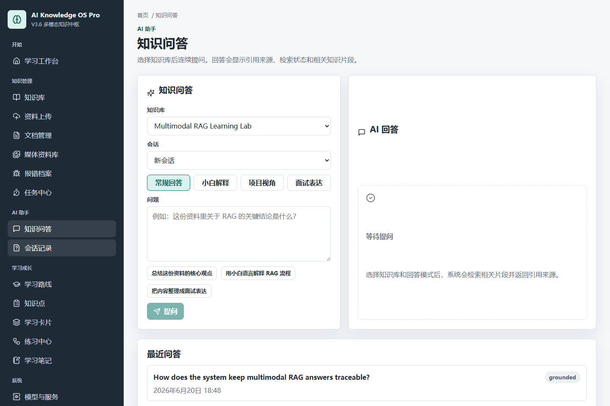
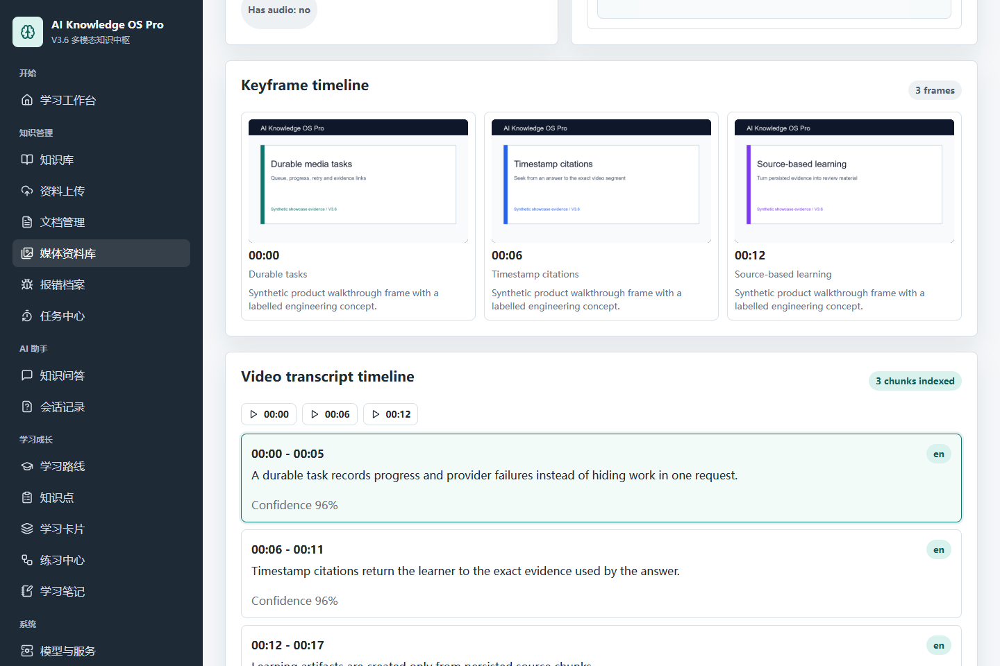
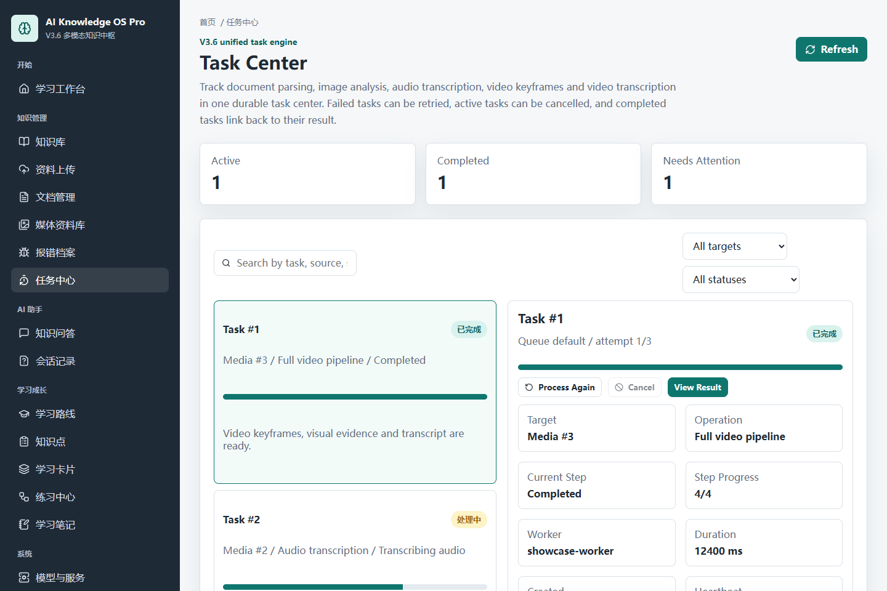
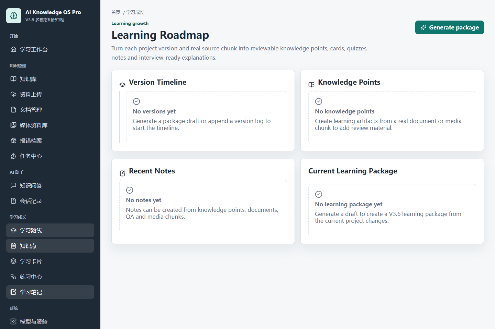
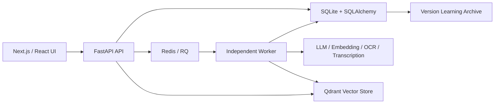
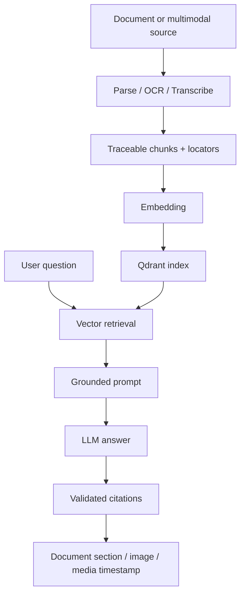
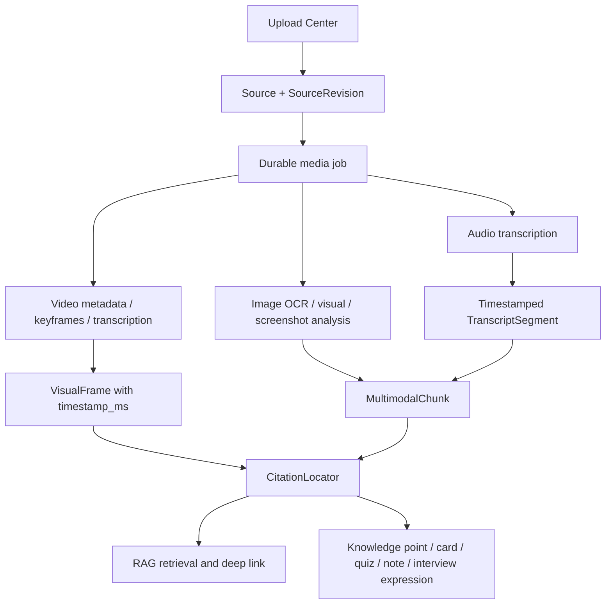

# AI Knowledge OS Pro

> 面向 AI 应用开发学习者的多模态个人知识操作系统：把项目资料、RAG 问答、媒体证据、后台任务和版本学习档案连接成一条可追溯的学习工作流。

[](https://github.com/DZH166/AI-Knowledge-OS-Pro/actions/workflows/ci.yml)
[](docs/v3_6_acceptance_report.md)
[](backend/requirements.txt)
[](frontend/package.json)
[](LICENSE)


## 项目定位

AI Knowledge OS Pro 不是一个只会“上传文件再聊天”的演示页面。它针对真实 AI 应用学习过程中的三个问题：

1. 项目资料分散，无法形成可检索、可引用的个人知识库。
2. 图片、音频、视频虽然能保存，但处理过程、失败原因和证据位置不可追踪。
3. 做完一个版本后，只剩代码，没有可复习、可讲解、可用于面试表达的学习档案。

V3.6 / 3.6.0 将文档、图片、音频和视频统一到持久化任务中心，并让 RAG 引用能返回文档片段、图片详情或媒体时间戳。所有模型能力都遵守真实模式边界：缺少 provider 配置时明确拒绝，不生成假 OCR、假字幕、假引用或假学习资料。

## 核心亮点

- **可追溯 RAG**：文档 chunk、图片 OCR、音频/视频转写统一进入 Qdrant，回答携带真实来源定位。
- **统一任务中心**：文档解析、图片 OCR、截图分析、音频转写、视频转写、关键帧和视觉分析共享 Redis/RQ 任务模型。
- **多模态证据跳转**：文档定位页码/章节，图片打开来源详情，音频和视频跳到时间戳并高亮转写片段。
- **视频学习工作台**：播放器、转写时间线、多关键帧、片段证据和学习操作在同一页面联动。
- **来源驱动学习资产**：从真实 chunk 生成知识点、卡片、练习题、笔记和面试表达，并保留来源 locator。
- **工程化交付**：Alembic 迁移、pytest、Next.js build、UTF-8 检查、版本一致性检查和 release 安全检查全部进入 CI。

## 产品截图

截图使用本地演示数据，不包含真实 API Key、私人资料、数据库或用户上传内容。完整演示顺序见 [Demo Showcase](docs/demo_showcase.md)。

| 上传与知识问答 | 媒体资料库 |
| --- | --- |
|  |  |
|  |  |

| 任务中心 | 学习档案 |
| --- | --- |
|  |  |

## 技术架构



| Layer | Technology | Responsibility |
| --- | --- | --- |
| Frontend | Next.js 15, React 19, TypeScript | Upload, Task Center, RAG chat, media evidence and learning UI |
| API | FastAPI, Pydantic | Product APIs, provider boundaries and error contracts |
| Relational data | SQLAlchemy, Alembic, SQLite | Sources, revisions, jobs, events, citations and learning artifacts |
| Task engine | Redis, RQ | Durable dispatch for document and media processing |
| Vector retrieval | Qdrant | Document and multimodal chunk retrieval |
| Model adapters | OpenAI-compatible APIs | LLM, embedding, OCR/vision and transcription |

更详细的数据边界和任务模型见 [Architecture](docs/architecture.md)。

## RAG 流程



系统不会在模型没有使用引用时强行补第一条检索结果。没有可用资料、索引不兼容或 provider 未配置时，会返回明确状态而不是伪造答案。

## 多模态处理流程



### 真实能力边界

| Capability | Configured | Missing provider |
| --- | --- | --- |
| LLM answer | Calls configured chat endpoint | `LLM_NOT_CONFIGURED`-style refusal |
| Embedding | Creates real vectors | Upload/index operation is blocked |
| Image OCR | Persists OCR chunks and locators | `OCR_NOT_CONFIGURED` |
| Audio/video transcription | Persists timestamped segments | `TRANSCRIPTION_NOT_CONFIGURED` |
| Visual description | Uses configured vision provider | Explicit NOT_CONFIGURED failure |
| Learning artifacts | Uses persisted source chunks | Empty or unprocessed sources are refused |

## Repository Structure

```text
backend/                 FastAPI application, models, services, migrations and tests
frontend/                Next.js product UI
docs/                    Architecture, learning archive, reports and demo assets
scripts/                 Learning package, encoding, version and release checks
.github/workflows/       GitHub Actions CI
.github/ISSUE_TEMPLATE/  Structured issue forms
```

## Quick Start

### 1. Configure environment

```powershell
Copy-Item .env.example .env
Copy-Item backend/.env.example backend/.env
Copy-Item frontend/.env.local.example frontend/.env.local
```

### 2. Start Qdrant and Redis

```powershell
docker compose up -d qdrant redis
```

### 3. Install backend and migrate

```powershell
python -m venv .venv
.\.venv\Scripts\Activate.ps1
pip install -r backend/requirements.txt
python -m alembic upgrade head
```

### 4. Start API and Worker

```powershell
python -m uvicorn app.main:app --app-dir backend --reload --host 127.0.0.1 --port 8000
```

In another terminal:

```powershell
python -m app.worker
```

### 5. Start frontend

```powershell
cd frontend
npm ci
npm run dev
```

- Product UI: `http://localhost:3000`
- OpenAPI: `http://localhost:8000/docs`
- System diagnostics: `http://localhost:3000/system`

Windows-specific FFmpeg and service notes are in [Local Setup](docs/local_setup_windows.md).

## Environment Variables

Never commit real values. `.env`, `backend/.env` and `frontend/.env.local` are ignored.

| Variable | Purpose | Required |
| --- | --- | --- |
| `DEMO_MODE` | Enables clearly labelled local demo adapters | No; defaults to `false` |
| `DATABASE_URL` | SQLAlchemy database URL | No; local SQLite default |
| `REDIS_URL` | RQ dispatch and Worker connection | For background tasks |
| `QDRANT_URL` | Vector database endpoint | For indexing and RAG |
| `LLM_API_KEY` | Chat completion provider | For real answers |
| `EMBEDDING_API_KEY` | Embedding provider | For real indexing/retrieval |
| `OCR_API_KEY` | OCR/vision endpoint | For image OCR and visual tasks |
| `TRANSCRIPTION_API_KEY` | Audio transcription endpoint | For audio/video transcription |
| `NEXT_PUBLIC_API_BASE_URL` | Browser-visible FastAPI base URL | Frontend deployment |

See [.env.example](.env.example), [backend/.env.example](backend/.env.example) and [frontend/.env.local.example](frontend/.env.local.example) for complete options.

## Verification

CI runs the same commands expected locally:

```powershell
python -m compileall backend/app backend/alembic scripts
python -m pytest
python -m alembic current
python scripts/check_encoding.py
python scripts/check_version.py

cd frontend
npm run typecheck
npm run build
```

Current verified baseline: **40 backend tests passed**, Alembic head `0006_v3_6_unified_media_tasks`, frontend typecheck passed and production build passed. The next verification run updates this count in the V3.6 acceptance report.

## CI and Release

[GitHub Actions CI](.github/workflows/ci.yml) validates backend, frontend, UTF-8 encoding, version consistency and release archive safety. The release job uploads a sanitized zip artifact.

```powershell
python scripts/release.py --version V3.6
python scripts/check_release.py --version V3.6
```

The archive must not contain `.env`, SQLite databases, uploads, logs, `node_modules`, `.next`, caches, keys or old releases. See [Release Checklist](docs/release_checklist.md).

## Learning Package

Generate a V3.6 draft from real repository changes, routes, dependencies and optional verification reports:

```powershell
python scripts/generate_learning_package.py \
  --version V3.6 \
  --from-ref HEAD~1 \
  --to-ref HEAD \
  --output docs/v3_6_learning_package_draft.json
```

Confirmed learning records are appended to [learning_log.md](docs/learning_log.md); stage delivery records are appended to [stage_delivery_log.md](docs/stage_delivery_log.md).

## Roadmap

### Delivered in V3.6

- Unified document and media task model with retry, cancel, progress and events.
- Image OCR, screenshot error archive, audio/video transcription and multi-keyframe video processing.
- Document/media citation deep links and player synchronization.
- Source-derived learning artifacts and version learning package automation.
- GitHub CI, project governance, encoding/version checks and safe release packaging.

### Deliberately out of scope

- Multi-user permissions and cloud tenancy.
- Large-scale Kubernetes deployment.
- Full knowledge graph and multi-agent workflow.
- Full shot-level scene segmentation and subtitle export.

See the detailed [Roadmap](docs/roadmap.md).

## Resume / Interview Expression

> I built a multimodal personal knowledge OS with FastAPI, Next.js, Qdrant and Redis/RQ. I unified document, image, audio and video processing under a durable task model, made RAG citations deep-link to document chunks or media timestamps, and generated learning artifacts only from persisted source evidence. I also added Alembic migrations, automated tests, GitHub Actions and sanitized release packaging so the project is demonstrable as a production-oriented AI application rather than a fake-data prototype.

## Documentation

- [Architecture](docs/architecture.md)
- [Demo Showcase](docs/demo_showcase.md)
- [RAG Pipeline](docs/rag_pipeline.md)
- [Task Flow](docs/ingestion_job_flow.md)
- [Roadmap](docs/roadmap.md)
- [V3.6 Acceptance Report](docs/v3_6_acceptance_report.md)
- [Learning Archive](docs/learning_log.md)
- [Contributing](CONTRIBUTING.md)
- [Security](SECURITY.md)

## License

Released under the [MIT License](LICENSE).
