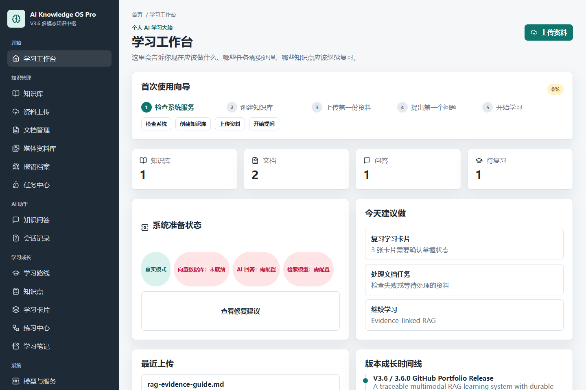
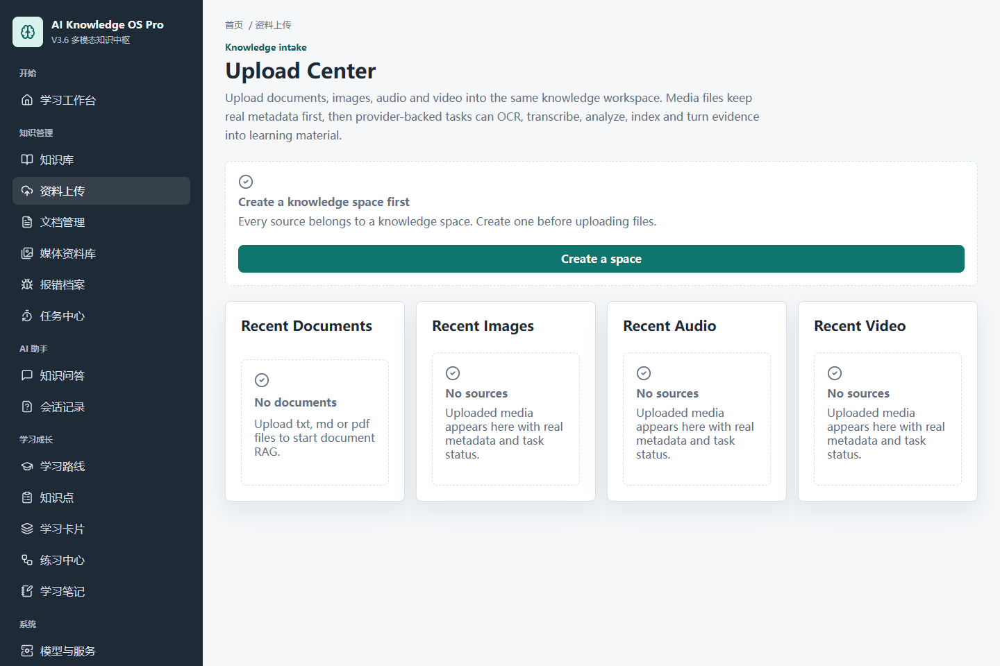
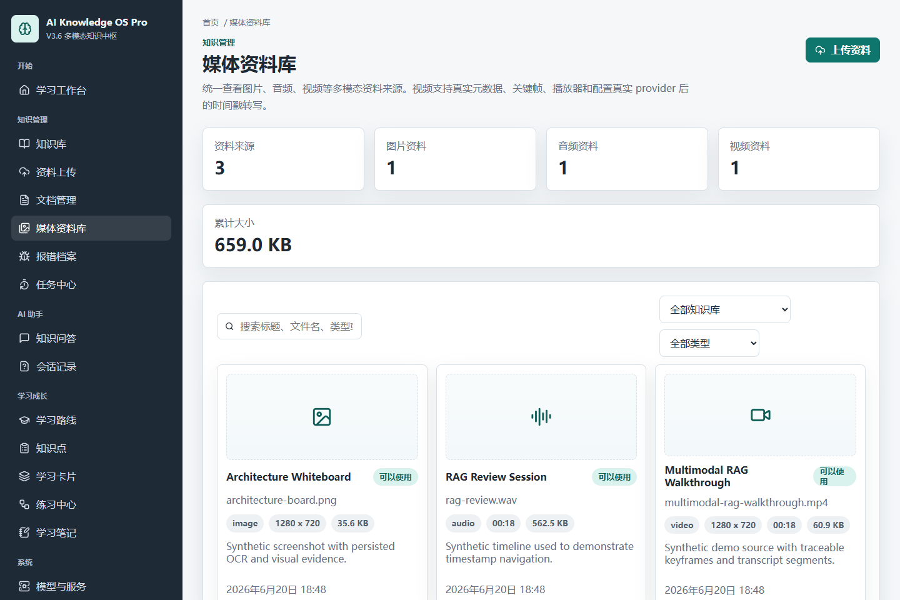
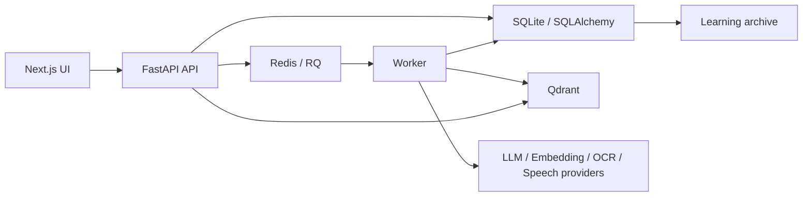
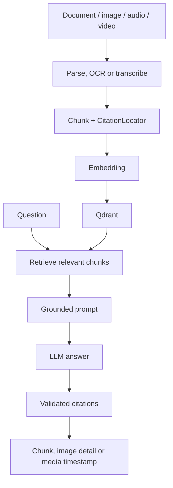
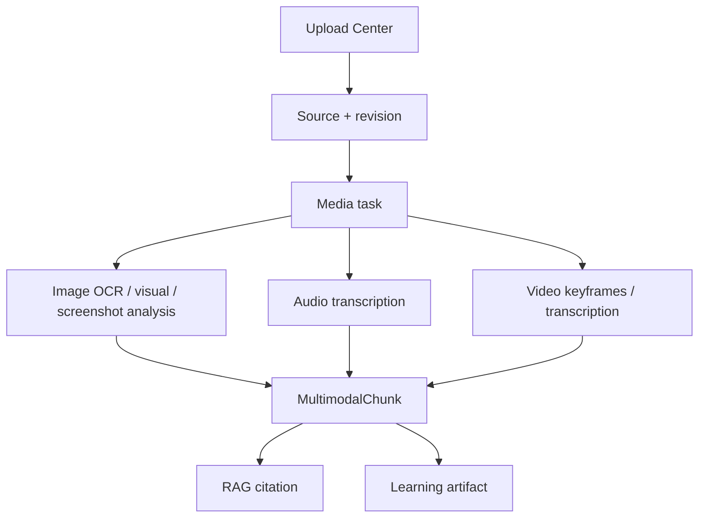
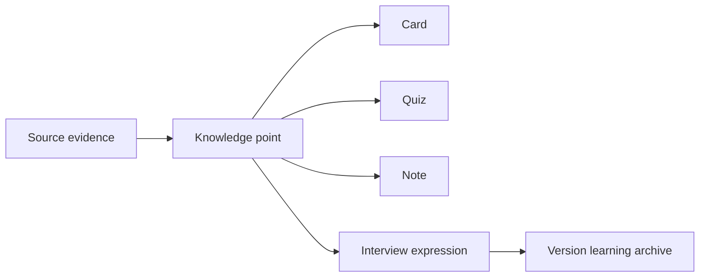

# AI Knowledge OS Pro

> Multimodal personal knowledge OS for AI application learners: project sources become searchable evidence, RAG answers, durable media tasks and versioned learning archives.

[](https://github.com/DZH166/AI-Knowledge-OS-Pro/actions/workflows/ci.yml)
[](docs/v4_3_release_readiness_report.md)
[](backend/requirements.txt)
[](backend/requirements.txt)
[](frontend/package.json)
[](LICENSE)



## 30-60 Second Demo

A Demo GIF is planned under `docs/assets/demo/v4_3_demo_walkthrough.gif`. It is not referenced as an image until captured, to avoid broken README media. Use the current walkthrough script instead:

- [Quickstart](docs/quickstart.md)
- [Demo mode boundary](docs/demo_mode.md)
- [60-second demo script](docs/demo_script.md)
- [Demo storyboard](docs/demo_storyboard.md)
- [Demo showcase guide](docs/demo_showcase.md)
- [Screenshot inventory](docs/assets/screenshots/README.md)

## Why This Project Exists

AI application learning often leaves three gaps:

1. Source material is scattered across documents, screenshots, audio and video.
2. RAG demos answer questions but do not reliably bring users back to the exact evidence.
3. Learners finish a version but lose the ability to explain what changed, why it matters and how to discuss it in interviews.

AI Knowledge OS Pro turns that workflow into a local product: sources are ingested, processed through observable tasks, retrieved with citations and converted into versioned learning records.

## Core Highlights

- Traceable RAG: document chunks and multimodal chunks keep source locators.
- Unified Task Center: document parsing, image OCR, screenshot analysis, audio transcription, video transcription and keyframes share durable job/event records.
- Multimodal citation jumps: documents jump to chunks, images to detail pages, audio/video to timestamps with transcript highlighting.
- Video learning page: player, transcript timeline, keyframes, evidence chunks and learning actions work together.
- Learning loop: real source chunks become knowledge points, cards, quizzes, notes and interview expressions.
- Engineering trust: CI, UTF-8 checks, secret checks, repo cleanliness checks, RAG evaluation, full regression smoke and release dry-run protect the GitHub portfolio.
- V4.3 release usability: README/docs links, README assets, demo closure, provider boundaries, API smoke and release checks are grouped behind executable quality gates.

## Feature Matrix

| Capability | Status | Requirement | Honest boundary |
| --- | --- | --- | --- |
| Knowledge spaces | Implemented | Local DB | Directly usable |
| txt/md/pdf upload and chunks | Implemented | Local backend | Scanned PDF OCR is not automatic |
| Qdrant semantic retrieval | Implemented | Qdrant + embedding provider | Missing embedding provider blocks real indexing |
| RAG answer | Implemented | LLM provider | Missing LLM returns explicit refusal |
| Image upload and metadata | Implemented | Pillow | Directly usable |
| Image OCR | Implemented | OCR/vision provider | Missing provider returns `OCR_NOT_CONFIGURED` |
| Audio upload and duration | Implemented | Mutagen/WAV parser | Directly usable for metadata |
| Audio transcription | Implemented | Speech-to-text provider | Missing provider returns `TRANSCRIPTION_NOT_CONFIGURED` |
| Video upload and keyframes | Implemented | FFmpeg/imageio-ffmpeg | Keyframes are real extracted/generated assets, not LLM output |
| Video transcription | Implemented | Speech-to-text provider | No fake subtitles |
| Task Center retry/cancel/events | Implemented | Redis/RQ for background dispatch | DB records remain visible without worker |
| Demo seed data | Implemented and hardened in V4.2 | `scripts/seed_demo_data.py`, `scripts/reset_demo_data.py`, `scripts/check_full_regression.py` | Synthetic, labelled and includes refusal/provider-boundary evidence |
| README/docs integrity | Implemented in V4.3 | `scripts/check_docs_links.py`, `scripts/check_readme_assets.py`, `scripts/check_all.py` | Checks local links/assets only; external GitHub availability is verified by CI |
| Subtitle export | Planned | Not implemented | Do not claim as delivered |
| Shot-level scene segmentation | Planned | Not implemented | Roadmap only |

## Product Screenshots

Screenshots use synthetic demo data and do not contain API keys, private documents or user uploads.

| Upload Center | Media Library |
| --- | --- |
|  |  |
|  |  |

| Task Center | Learning Archive |
| --- | --- |
|  |  |

## System Architecture



More interview-friendly diagrams are in [Architecture Diagrams](docs/architecture_diagram.md).

## RAG Flow



## Multimodal Processing Flow



## Learning Loop



## Tech Stack

| Layer | Technology |
| --- | --- |
| Frontend | Next.js 15, React 19, TypeScript |
| Backend | FastAPI, Pydantic, SQLAlchemy, Alembic |
| Local DB | SQLite |
| Vector DB | Qdrant |
| Tasks | Redis, RQ, persistent job events |
| Providers | OpenAI-compatible LLM, Embedding, OCR/vision and Speech-to-text |
| Verification | pytest, compileall, TypeScript typecheck, Next.js build, GitHub Actions |

## Local Quick Start

For the maintained step-by-step guide, see [Quickstart](docs/quickstart.md). For local engineering notes, see [Local Development](docs/local_development.md).

```powershell
git clone https://github.com/DZH166/AI-Knowledge-OS-Pro.git
cd AI-Knowledge-OS-Pro
Copy-Item .env.example .env
Copy-Item backend/.env.example backend/.env
Copy-Item frontend/.env.local.example frontend/.env.local
```

Start local services:

```powershell
docker compose up -d redis qdrant
```

Install backend and migrate:

```powershell
python -m venv .venv
.\.venv\Scripts\Activate.ps1
pip install -r backend/requirements.txt
python -m alembic upgrade head
python -m uvicorn app.main:app --app-dir backend --reload --host 127.0.0.1 --port 8000
```

Start frontend in another terminal:

```powershell
cd frontend
npm ci
npm run dev
```

Open `http://localhost:3000`.

## Docker Demo Start

The current Compose file starts Redis and Qdrant. The API and frontend run locally so the demo remains easy to inspect and debug.

```powershell
python scripts/setup_demo.py --reset
```

If Docker is already running or unavailable, skip service startup and only seed/check data:

```powershell
python scripts/setup_demo.py --skip-docker --reset
```

Then start the app with the printed environment variables:

```powershell
$env:DATABASE_URL="sqlite:///C:/path/to/AI Knowledge OS Pro/backend/data/demo_showcase.db"
$env:DEMO_MODE="true"
python -m uvicorn app.main:app --app-dir backend --reload --host 127.0.0.1 --port 8000
```

```powershell
cd frontend
$env:NEXT_PUBLIC_API_BASE_URL="http://127.0.0.1:8000"
npm run dev
```

Check demo readiness any time:

```powershell
python scripts/check_demo_ready.py --database-path backend/data/demo_showcase.db
```

## Environment Variables

Never commit real values. `.env`, `backend/.env` and `frontend/.env.local` are ignored.

| Variable | Purpose | Required |
| --- | --- | --- |
| `DEMO_MODE` | Labels runtime as demo and uses demo-safe behavior where available | Optional |
| `DATABASE_URL` | SQLAlchemy database URL | Optional, defaults to local SQLite |
| `REDIS_URL` | Redis/RQ dispatch | Required for background workers |
| `QDRANT_URL` | Vector database endpoint | Required for retrieval/indexing |
| `LLM_API_KEY` | Chat completion provider | Required for real answers |
| `EMBEDDING_API_KEY` | Embedding provider | Required for real semantic retrieval |
| `OCR_API_KEY` | OCR/vision endpoint | Required for OCR and vision tasks |
| `TRANSCRIPTION_API_KEY` | Speech-to-text endpoint | Required for audio/video transcription |
| `NEXT_PUBLIC_API_BASE_URL` | Browser-visible FastAPI base URL | Required for frontend deployment |

## Demo Mode vs Real Mode

| Mode | What it can show | What it must not do |
| --- | --- | --- |
| Demo | Synthetic knowledge space, sources, tasks, Q&A, cards and learning logs | Pretend synthetic text is real provider output |
| Real | Calls configured providers and persists real outputs | Silently fabricate OCR, transcripts, answers or citations |

Missing provider keys produce explicit NOT_CONFIGURED-style errors. Demo mode is for workflow presentation, not fake AI capability.

## Tests And Build

```powershell
python -m compileall backend/app scripts
python -m pytest
python scripts/check_encoding.py
python scripts/check_secrets.py
python scripts/check_repo_clean.py
python scripts/check_docs_links.py
python scripts/check_readme_assets.py
python scripts/check_frontend_smoke.py
python scripts/check_demo_ready.py --database-path backend/data/demo_showcase.db
python scripts/evaluate_rag.py --demo --database-path backend/data/demo_showcase.db
python scripts/check_full_regression.py --database-path backend/data/demo_showcase.db
python scripts/release.py --version V4.3 --dry-run
python scripts/check_all.py --full
```

```powershell
cd frontend
npm run typecheck
npm run build
```

CI runs these checks without calling paid provider APIs.

## Project Structure

```text
backend/                 FastAPI app, SQLAlchemy models, services, migrations and tests
frontend/                Next.js product UI
docs/                    Architecture, reports, screenshots, demo and learning archives
scripts/                 Demo, verification, learning package and release utilities
.github/workflows/       GitHub Actions CI
.github/ISSUE_TEMPLATE/  Issue forms and PR template
```

## Documentation Map

| Area | Docs |
| --- | --- |
| Demo and setup | [Quickstart](docs/quickstart.md), [Demo Mode](docs/demo_mode.md), [Local Development](docs/local_development.md), [Environment Variables](docs/environment_variables.md), [Provider Diagnostics](docs/provider_diagnostics.md) |
| Architecture and flows | [Architecture](docs/architecture.md), [Architecture Diagrams](docs/architecture_diagram.md), [RAG Flow](docs/rag_flow.md), [Multimodal Pipeline](docs/multimodal_pipeline.md), [Task Queue Flow](docs/task_queue_flow.md), [Citation Flow](docs/citation_flow.md), [Learning Loop](docs/learning_loop.md) |
| Release and governance | [Release Process](docs/release_process.md), [Versioning](docs/versioning.md), [Commit Convention](docs/commit_convention.md), [Document Quality Checklist](docs/document_quality_checklist.md), [Release Checklist](docs/github_release_checklist.md) |
| V4.x modules and reports | [RAG Evaluation](docs/rag_evaluation.md), [Hybrid Retrieval](docs/hybrid_retrieval.md), [Code Repository Ingestion](docs/code_repository_ingestion.md), [Portfolio System](docs/portfolio_system.md), [Interview System](docs/interview_system.md), [Observability](docs/observability.md), [V4.2 Full Regression](docs/v4_2_full_regression_report.md), [V4.2 Acceptance](docs/v4_2_acceptance_report.md), [V4.3 Release Readiness](docs/v4_3_release_readiness_report.md), [V4.3 Quality Gates](docs/v4_3_quality_gate_report.md), [V4.3 README Assets](docs/v4_3_readme_asset_report.md), [V4.3 UX Error States](docs/v4_3_ux_error_state_report.md), [V4.4 Planning](docs/v4_4_planning.md) |

## Current Limitations

- Real LLM, embedding, OCR and transcription need configured providers.
- Docker Compose starts Redis/Qdrant but not a full production deployment.
- Subtitle export is planned but not implemented.
- Shot-level scene segmentation is planned but not implemented.
- Multi-user permissions, cloud tenancy and Kubernetes deployment are out of scope.

## Version Roadmap

- V1: Knowledge spaces, document upload, chunking, embeddings, Qdrant RAG and learning archive.
- V2/V2.5: Real-mode governance, document operations, learning cards and product UI.
- V3: Redis/RQ task engine and multimodal source model.
- V3.1-V3.5: Image metadata/OCR, screenshot error archive, audio and video timestamp citations.
- V3.6: Unified media tasks, citation deep links, multi-keyframes and source-derived learning artifacts.
- V3.7: GitHub showcase, one-click demo setup, release dry-run, secret checks, architecture/resume docs and clearer capability boundaries.
- V3.8: GitHub portfolio documentation map, demo reset workflow, quickstart/demo/development docs and V4.0 roadmap module specifications.
- V3.9: RAG demo evaluation, frontend smoke gates and navigation IA split.
- V4.0: Learning roadmap relations, hybrid retrieval foundation, code repository ingestion and portfolio pages.
- V4.1: Codebase inventory, dead-code review, historical report archive and architecture boundary cleanup.
- V4.2: Full regression checklist, hardened synthetic demo, stronger RAG quality evaluation, release-readiness gates and updated portfolio documentation.
- V4.3: README/docs link integrity, README asset checks, demo walkthrough validation, provider-boundary tests, API regression coverage and unified quality gate orchestration.
- V4.4 planned: browser E2E demo smoke, citation-jump validation, runtime observability snapshots and optional provider-backed evaluation.

See [Roadmap](docs/roadmap.md).

## Resume Expression

> Built a multimodal RAG personal knowledge OS with FastAPI, Next.js, Qdrant and Redis/RQ. The system ingests documents, images, audio and video; tracks provider-backed processing through durable tasks; returns citations to document chunks or media timestamps; and turns source evidence into learning cards, notes and interview-ready explanations. Added CI, demo seeding, secret checks and release dry-run to make the project credible as a GitHub portfolio.

Detailed interview notes: [Resume And Interview Pitch](docs/resume_pitch.md).

## License

MIT. See [LICENSE](LICENSE).
