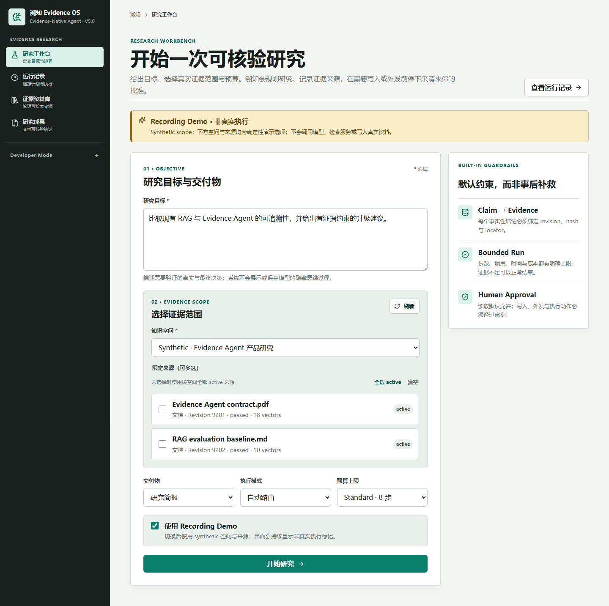
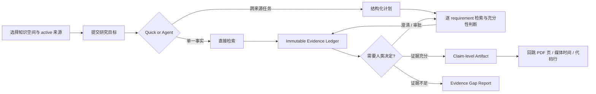
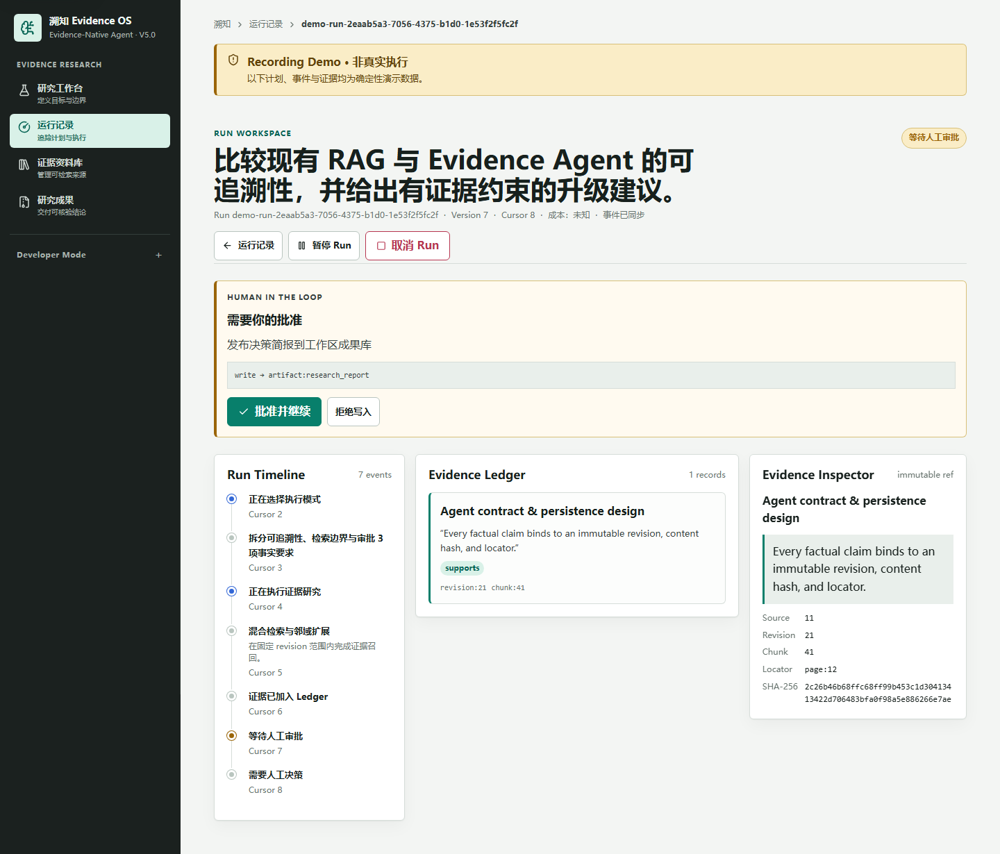
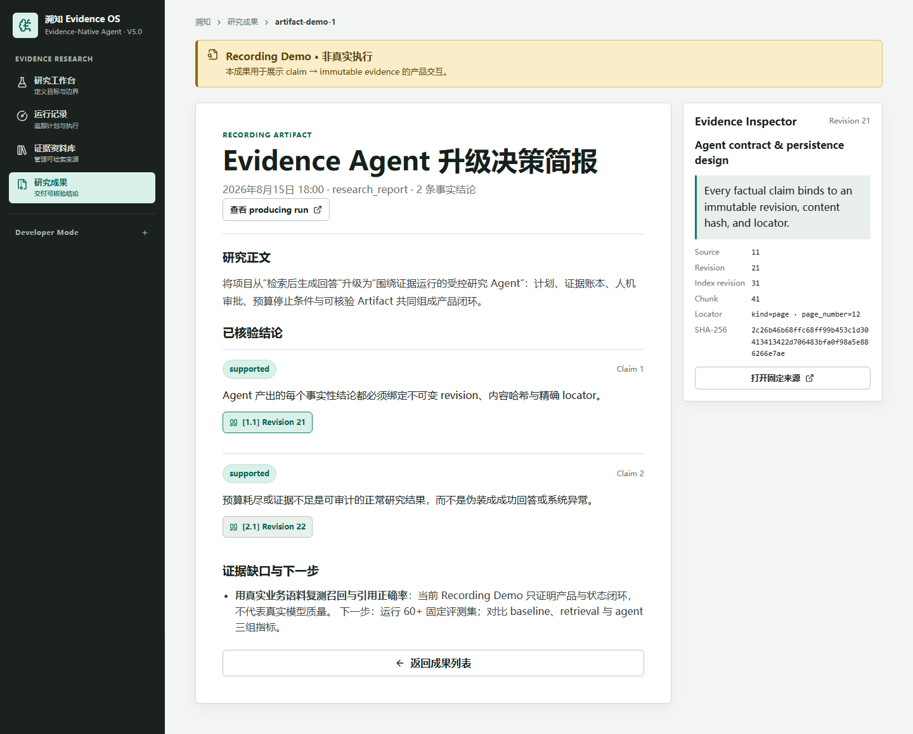
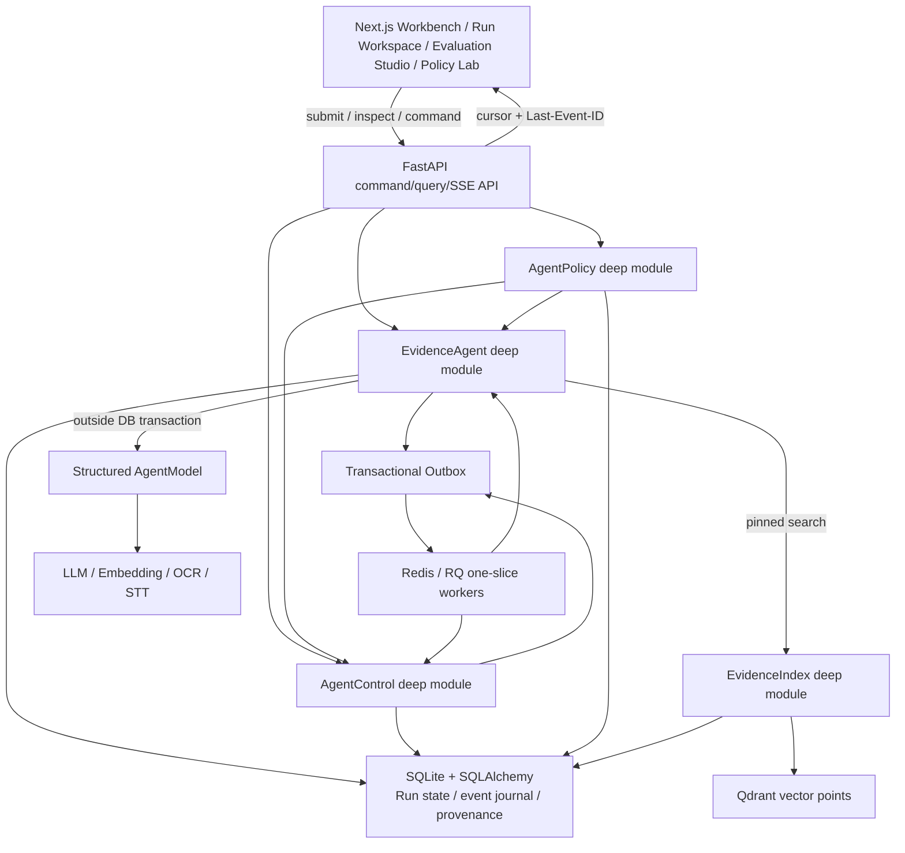

# 溯知 Evidence OS

> Evidence-Native Research Agent — 以 RAG 为证据引擎，把“问一句、答一段”升级为可计划、可暂停、可审阅、可复现的研究智能体。

[](https://github.com/DZH166/AI-Knowledge-OS-Pro/actions/workflows/ci.yml)
[](docs/v5_3_adaptive_policy_retrieval/acceptance_report.md)
[](backend/requirements.txt)
[](backend/requirements.txt)
[](frontend/package.json)
[](LICENSE)



## 它解决什么问题

传统 RAG 通常止步于“检索几段文本，再让模型生成答案”。一旦来源发生更新、任务跨越多份资料、执行中断，或者用户要求解释“这条结论究竟来自哪一版证据”，系统就很难给出可信回答。

溯知把 RAG 放在 Agent 的中心，但不把模型当作系统权限边界：

| 普通 RAG | 溯知 Evidence Agent |
| --- | --- |
| 一次 query → answer | goal → route → plan → retrieve → assess → artifact |
| citation 只指向当前文本片段 | EvidenceRef 固定 source/revision/index/chunk/hash/locator |
| 来源更新可能静默改变答案 | 新任务使用 active revision，已开始任务继续使用 pinned revision |
| 请求失败后从头开始 | checkpoint、event journal、outbox 与幂等 command 支持恢复 |
| 模型直接决定下一步 | 工具、scope、预算、审批和取消由确定性策略控制 |
| 最终只返回一段文本 | 生成逐 claim 绑定证据的 Artifact，证据不足则输出 Gap Report |

## 核心工作流





## 真正体现工程水准的部分

- Evidence lifecycle：所有新文档、代码、图片、音频与视频证据统一进入 `Stage → Upsert → Activate`；数据库约束保证每个 Source 最多一个 active revision/index。
- 跨存储一致性：Qdrant point 先有 manifest，再执行写入；失败可补偿，reconciler 默认 dry-run，能够发现 orphan、missing 与 payload mismatch。
- Durable Agent runtime：Run、Plan、Requirement、ToolCall、ModelCall、Checkpoint、Gate、Event 与 Artifact 都是持久状态，不依赖浏览器连接存活。
- 受控模型智能：生产 `AgentModel` 使用严格结构化输出完成 route、plan、sufficiency/next-query 与 synthesis；provider 调用发生在 SQL 事务外，非法结构只允许一次受预算约束的 repair，未配置真实模型时明确拒绝运行。
- 硬预算与 execution fence：step、tool、model、token、time、cost、query rewrite、无新证据轮数均有边界；取消会推进 epoch，迟到结果不能写回。
- 持久恢复：Run 与 outbox 使用原子 lease/CAS；Worker 重启会校验 checkpoint，恢复中断的只读检索，对未知模型结果 fail-closed；poison message 进入有界重试与 dead-letter，不阻塞同批任务。
- Human-in-the-loop：clarification、approval、reject、pause、resume、cancel 都是带 version/digest 的幂等 command，而不是前端假状态。
- 可核验证据：每个 factual claim 至少关联一个 EvidenceRef；Artifact → Claim → Evidence → Revision → Source 支持 revision/hash/chunk 精确深链与历史退休版本回放。
- 多模态定位：当前与历史 revision 都支持文档页、媒体时间戳、OCR 区域与代码行 locator，并经过浏览器深链回归。
- 产品边界清晰：主导航只保留 Workbench、Agent Runs、Library、Artifacts；诊断和旧功能收进 Developer Mode。



## 可复现实验，而不是“看起来很智能”

仓库内置 [60 条固定评测集](evaluation/v5/cases.jsonl)，覆盖单跳、多跳、跨模态、版本冲突、证据不足、prompt injection 与取消恢复。报告通过真实模块接口执行：

```text
EvidenceIndex.stage/upsert/activate
  → HybridAgentSearch (pinned snapshot + RRF; Agent rerank disabled)
  → EvidenceAgent.submit
  → AgentRunner.advance_one

Independent retrieval evaluation arms: dense / sparse / fusion / labeled recording rerank
```

当前确定性评测结果来自 [原始 JSON](docs/v5_agentic_rag/evaluation_report.json)：

| 指标 | 结果 |
| --- | ---: |
| 固定场景通过率 | 60 / 60 |
| Fusion Recall@10 | 1.0000 |
| Citation completeness | 1.0000 |
| Immutable evidence identity | 1.0000 |
| Active-revision precision | 1.0000 |
| Recovery scenarios | 6 / 6 |
| Unauthorized action rate | 0.0000 |
| 多跳 Agent task success | 100% |
| V4.9-style single-shot proxy | 41.67% |
| 多跳提升 | +58.33 percentage points |

边界说明：这是 synthetic fixed corpus + deterministic recording model/embedding 的架构与回归评测，不是真实大模型质量基准；Agent 分支实际经过 `HybridAgentSearch` 的 pinned-snapshot dense/sparse RRF，固定报告中明确禁用 Agent reranker。独立 rerank 评测臂使用带标签的 deterministic feature-overlap recording adapter，仅验证重排契约。“V4.9-style”是同一 canonical corpus 上、top-4 单次检索的可重复代理实验，不冒充历史版本原样复跑。仓库已提供可选真实 HTTP rerank Adapter，但固定报告和默认环境未配置它，因此不宣称生产 rerank 质量。

V5.2 把这套评测变成可操作的产品能力：

- `/evaluations` 启动并保存固定评测，显示指标、门禁、类别和 60 个案例。
- 两份快照只有在 schema 与 dataset hash 一致时才能比较，否则明确显示不可比较。
- `/runs/{run_id}/trace` 重放持久化事件，核对顺序、Trace ID、终态和检查点。
- 私有事件、prompt、工具参数和 checkpoint state 只显示脱敏标记，不进入前端响应。
- 失败由确定性 Triage 分类，并给出可重试性与下一步动作。

V5.3 进一步把检索策略做成可治理的产品能力：

- `/policies` 保存不可变策略版本，支持草稿、活动、退役和审计回滚。
- 事实型、比较型和时间型 requirement 使用不同 Top-K，并应用分数、来源多样性和相邻上下文边界。
- 每个 Run 固定策略 id/version/hash/config；后续启用或回滚不会改变进行中或历史任务。
- 候选策略可以对历史决策做无副作用反事实模拟，并通过固定 60 场景评测后才能启用。
- Policy Lab 串起“创建 → 比较 → 模拟 → 评测 → 启用 → 固定新 Run → 回滚”的完整流程。

完整的通俗技术解释见 [V5.3 策略与自适应检索：通俗解释版](docs/v5_3_adaptive_policy_retrieval/plain_language_guide.md)。

复现：

```powershell
python scripts/evaluate_agentic_rag.py --mode demo --output docs/v5_agentic_rag/evaluation_report.json
python scripts/check_v5_acceptance.py
```

## 架构



四个公开模块接口刻意保持很小：

```text
EvidenceIndex.command / query / search
EvidenceAgent.submit / inspect / follow
AgentControl.submit / inspect / execute / recover
AgentPolicy.submit / inspect / simulate
```

这让 SQL、Qdrant、RQ、SSE 和模型 provider 都被封装在稳定 seam 后面，便于替换、故障注入和 AI 辅助维护。完整设计见 [V5 Spec](docs/v5_agentic_rag/spec.md) 与 [Implementation Plan](docs/v5_agentic_rag/plan.md)。

## 五分钟本地启动

要求：Python 3.12、Node.js 20、Docker。

```powershell
git clone https://github.com/DZH166/AI-Knowledge-OS-Pro.git
cd AI-Knowledge-OS-Pro
Copy-Item .env.example .env
Copy-Item backend/.env.example backend/.env
Copy-Item frontend/.env.local.example frontend/.env.local
docker compose up -d redis qdrant
```

后端：

```powershell
python -m venv .venv
.\.venv\Scripts\Activate.ps1
pip install -r backend/requirements.txt
python -m alembic upgrade head
python -m uvicorn app.main:app --app-dir backend --reload --host 127.0.0.1 --port 8000
```

Agent / ingestion worker（另一个已激活虚拟环境的终端）：

```powershell
cd backend
python -m app.worker
```

Worker 同时消费 RQ 并派发 durable SQL outbox；只启动 Uvicorn 不会执行已排队的 Agent Run。

前端（第三个终端）：

```powershell
cd frontend
npm ci
$env:NEXT_PUBLIC_API_BASE_URL="http://127.0.0.1:8000"
npm run dev
```

打开：

- 真实接口模式：`http://127.0.0.1:3000/workbench`
- 明确标记的 Recording Demo：`http://127.0.0.1:3000/workbench?demo=1`
- API 文档：`http://127.0.0.1:8000/docs`

真实模型、embedding、OCR 和转写需要在本地环境文件配置 provider；缺少配置时系统返回明确错误，不静默生成假结果。

## 关键 API

| Purpose | Endpoint |
| --- | --- |
| 创建/列出 Run | `POST/GET /api/v1/evidence-runs` |
| 读取 Run projection | `GET /api/v1/evidence-runs/{run_id}` |
| 人工决定与取消 | `POST /api/v1/evidence-runs/{run_id}/commands` |
| 可恢复事件流 | `GET /api/v1/evidence-runs/{run_id}/stream` |
| 运行轨迹与投影重放 | `GET /api/v1/evidence-runs/{run_id}/trace` |
| 启动/列出固定评测 | `POST/GET /api/v1/agent-evaluations` |
| 评测详情与对比 | `GET /api/v1/agent-evaluations/{id}`、`/compare` |
| Artifact catalog/detail | `GET /api/v1/artifacts`、`/{artifact_id}` |
| Evidence detail | `GET /api/v1/evidence/{evidence_id}` |

SSE 只公开状态、计划、工具结果、证据关系与产物事件，不公开 chain-of-thought。

## 验证

```powershell
python -m compileall backend/app scripts
python -m ruff check backend/app backend/tests scripts
python -m pytest backend/tests -q
python -m alembic heads
python -m alembic upgrade head
python scripts/evaluate_agentic_rag.py --mode demo --output docs/v5_agentic_rag/evaluation_report.json
python scripts/check_v5_acceptance.py

cd frontend
npm ci
npm run lint
npm run typecheck
npm run test:unit
npm run build
npm run test:e2e:strict
npm audit --omit=dev --audit-level=high
```

CI 运行后端完整回归与迁移、60 场景评测、前端 lint/unit/build/audit、Chromium Agent/citation E2E，以及 release archive 安全检查。

## 项目结构

```text
backend/app/modules/evidence_index/   revision lifecycle、Saga、search、reconciler
backend/app/modules/evidence_agent/   state machine、controller、budget、journal
backend/app/modules/agent_control/    trace、replay、evaluation、comparison、triage
backend/app/modules/agent_policy/     version、adaptive decision、simulation、activation、rollback
backend/app/api/                      command/query/SSE adapters
backend/app/tasks/                    RQ one-slice workers
frontend/modules/evidence-agent/      runtime contracts、HTTP/SSE/Recording adapters
frontend/components/evidence-agent/   Workbench、Run、Evidence、Artifact product UI
frontend/components/agent-control/    Run Trace、Evaluation Studio、snapshot comparison
frontend/components/agent-policy/     Policy Lab、diff、simulation、release control
evaluation/v5/                        fixed corpus and reviewed cases
docs/v5_agentic_rag/                  spec、plan、checklist、evaluation、acceptance
```

## 当前边界

- 默认面向单用户本地工作区；多租户鉴权、配额与云部署不在 V5.3 范围。
- SQLite 适合个人项目和演示，不代表生产级横向扩展方案。
- 真实 provider 的答案质量、延迟和费用取决于你的配置；仓库中的固定报告不调用付费 API。
- 可选真实 HTTP rerank Adapter 只有在 `RERANK_API_KEY`、`RERANK_URL`、`RERANK_MODEL` 三项完整时启用；默认环境和固定报告未配置，系统会诚实退化到 dense/sparse fusion。
- Reconciler 能识别 missing vector 并标记 rebuild，但不会在没有原始 embedding 时凭空重建。
- 代码仍保留 V4.x Developer Mode 页面用于兼容与工程诊断；核心产品路径已经收敛到四个一级入口。

## 简历表达

> 独立设计并实现“溯知 Evidence OS”，将多模态 RAG 升级为 evidence-native research agent。以 immutable revision/index/chunk provenance 保证引用可回放，通过 transactional outbox、checkpoint、idempotent command 与 execution fence 实现可恢复 Agent 执行；构建版本化 AgentPolicy、adaptive retrieval、counterfactual simulation、Evaluation Studio 与 Run Trace，并以候选策略评测门禁和真实 Redis/Qdrant/RQ/Chromium 流程控制上线与回滚。

面试时建议重点讲三件事：为什么 Agent 之前必须先修证据身份、如何避免取消后的迟到结果污染状态、为什么模型不能拥有 scope/permission/budget 的最终决定权。

## 名字

“溯知”强调从结论反向追溯到知识来源；`Evidence OS` 强调它不是聊天壳，而是一套围绕 evidence lifecycle、Agent execution 与 review artifact 组织的工作系统。英文定位统一为 `Evidence-Native Research Agent`。

## License

MIT，见 [LICENSE](LICENSE)。
