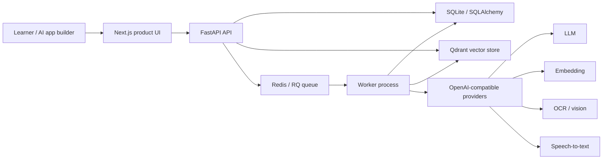
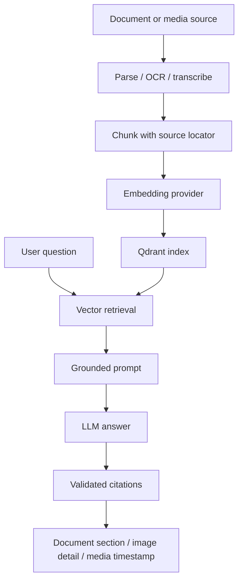
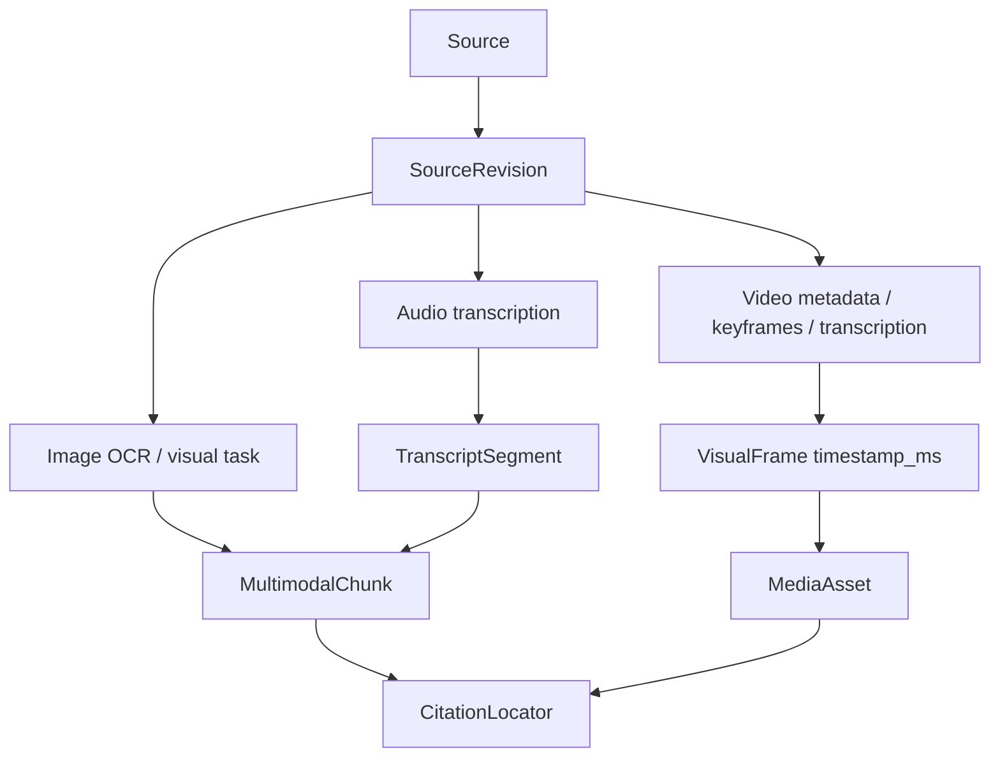
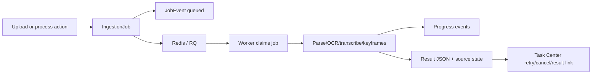
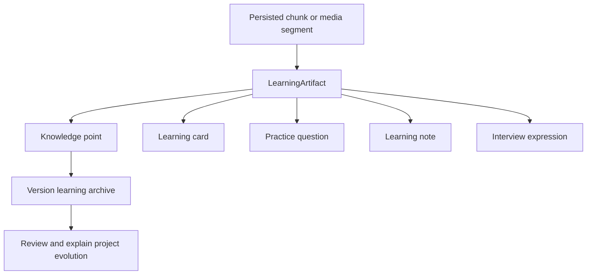
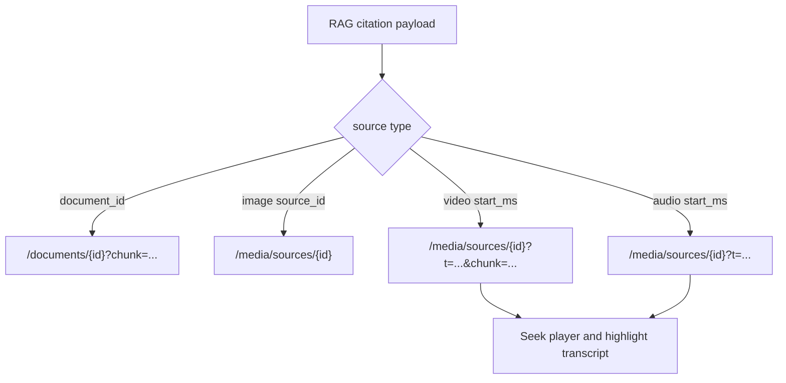
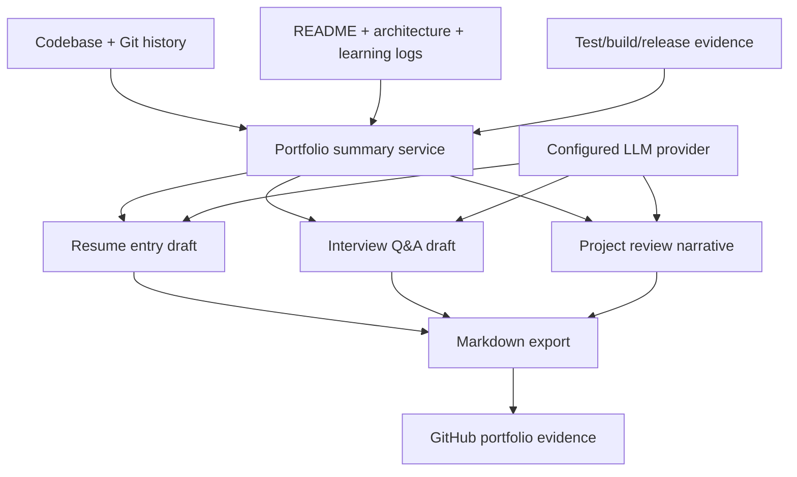

# Architecture Diagrams

These Mermaid diagrams are intentionally interview-friendly. They show the product boundary, not every implementation class.

## 1. System Architecture

## 2. RAG Flow

## 3. Multimodal Processing Flow

## 4. Task Queue Flow

## 5. Learning Loop Flow

## 6. Citation Jump Flow

## 7. Portfolio Generation Flow

